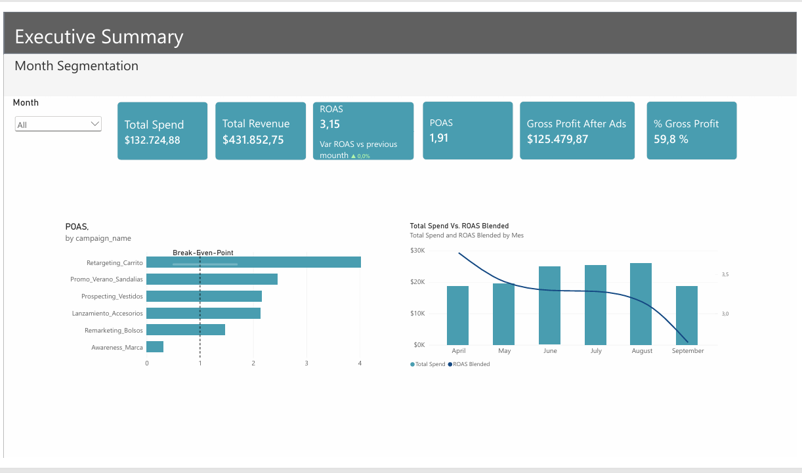
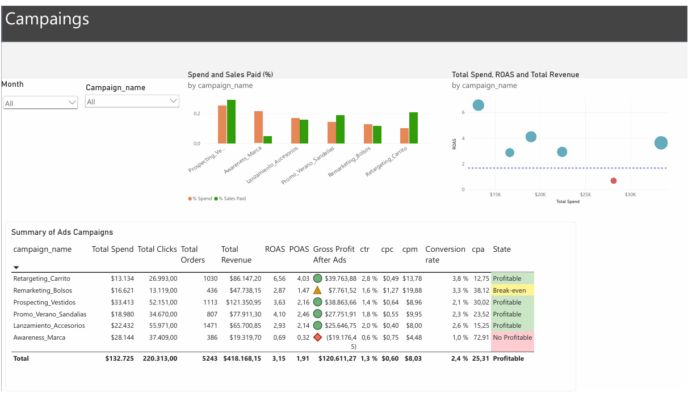
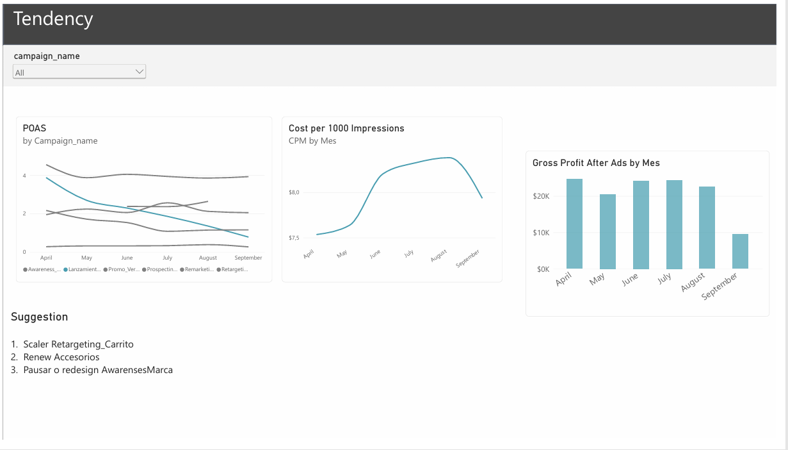

# 📊 Integración de datos publicitarios: Meta Ads + Shopify

**Abril a septiembre de 2026**

Dashboard de Business Intelligence que une el gasto en Meta Ads con las ventas de Shopify para responder una pregunta clave: **¿qué campañas generan ganancia real y cuáles pierden dinero?**




## Resultados clave

| Inversión en anuncios | Ventas pagadas | ROAS | POAS | Ganancia después de publicidad |
|:---:|:---:|:---:|:---:|:---:|
| **$132.725** | **$418.168** | **3,15** | **1,91** | **$120.611** |

- ✅ **Retargeting_Carrito** es la campaña más rentable (ROAS 6,56) y la que menos presupuesto recibe.
- ❌ **Awareness_Marca** usa el 21% del presupuesto y pierde $19.176 (ROAS 0,69).
- ⚠️ El ROAS de la tienda bajó de 3,77 en abril a 2,63 en septiembre.

## Contenido

- [Dashboard](#dashboard)
- [Análisis: hallazgos principales](#análisis-hallazgos-principales)
- [Recomendaciones](#recomendaciones)
- [Cómo se construyó](#cómo-se-construyó)
- [Métricas](#métricas)
- [Estructura del repositorio](#estructura-del-repositorio)

## Dashboard

El dashboard de Power BI tiene tres páginas. También puedes ver la [versión en PDF](dashboard/dashboard_meta_shopify.pdf).

### 1. Executive Summary
¿La publicidad está ganando dinero? Tarjetas con Spend, Revenue, ROAS (con variación vs mes anterior), POAS, Profit after ads y Gross margin %; POAS por campaña y tendencia mensual de ROAS y gasto.

### 2. Campaigns
¿Qué campañas escalar, optimizar o apagar? Tabla de campañas con estado de rentabilidad por color, % del gasto vs % de ventas y dispersión de gasto vs ROAS con el break-even (ROAS 1,67).



### 3. Tendency
¿Qué está empeorando con el tiempo? ROAS por campaña y mes, CPM, ganancia mensual después de publicidad, y tasa de conversión vs CPA.



## Análisis: hallazgos principales

**1. La publicidad es rentable en conjunto, pero cada vez menos.**
En 6 meses se invirtieron $132.725 en Meta Ads, que generaron $418.168 en ventas pagadas (ROAS 3,15) y una ganancia después de publicidad de $120.611 (POAS 1,91). Sin embargo, el ROAS de la tienda bajó de 3,77 en abril a 2,63 en septiembre, y la ganancia mensual cayó de $24.575 a $9.460. La caída se acelera en septiembre (ROAS pagado ▼ 21,7% frente a agosto).

**2. Una sola campaña pierde dinero: Awareness_Marca.**
Se lleva el 21,2% del presupuesto ($28.144), pero solo aporta el 4,6% de las ventas pagadas. Su ROAS es 0,69, muy por debajo del break-even de 1,67, y pierde $19.176. Es una campaña de reconocimiento de marca, así que no se espera que venda directamente, pero su costo debe justificarse con otras métricas (alcance, búsquedas de marca) o reducirse.

**3. Retargeting_Carrito es la campaña más eficiente y la menos aprovechada.**
Tiene el ROAS más alto (6,56) y el mejor POAS (4,03), estable todos los meses, pero recibe el menor presupuesto (10% del total). Es la candidata principal para recibir más inversión.

**4. Lanzamiento_Accesorios muestra fatiga del anuncio.**
Su ROAS cae todos los meses: 5,29 en abril, 3,69 en mayo, 3,12 en junio, 2,54 en julio, 1,86 en agosto y 1,07 en septiembre. El CPM se mantiene estable (≈ $8), así que el problema no es el costo, sino que el público ya vio el anuncio y responde menos. Necesita creativos nuevos.

**5. Remarketing_Bolsos está cerca del límite porque su audiencia se encarece.**
Su CPM pasó de $12,7 en abril a $31,6 en septiembre (2,5 veces más caro), y su ROAS bajó de 4,22 a 2,27. Gana solo $7.762 en el periodo (POAS 1,47). Conviene ampliar o renovar la audiencia antes de que pase a pérdida.

**6. Prospecting_Vestidos y Promo_Verano_Sandalias son las campañas sólidas.**
Vestidos genera las mayores ventas ($121.351) con un ROAS estable entre 3,25 y 4,30. Sandalias, activa solo de junio a agosto, logró ROAS 4,10. Su fin en septiembre explica parte de la caída de ese mes.

**7. Los clientes compran menos después del clic.**
La tasa de conversión de la tienda bajó de 3,0% a 2,0% y el costo por venta (CPA) subió de $18,87 a $31,50. Los anuncios siguen trayendo tráfico, pero convierte peor.

## Recomendaciones

1. **Escalar Retargeting_Carrito**, aumentando su presupuesto de forma gradual y vigilando que el ROAS se mantenga sobre 4.
2. **Reducir o rediseñar Awareness_Marca**, y mover parte de ese presupuesto a Retargeting y Vestidos.
3. **Renovar los creativos de Lanzamiento_Accesorios**, o pausarla si el ROAS no supera el break-even.
4. **Ampliar la audiencia de Remarketing_Bolsos** para bajar el CPM.
5. **Revisar la experiencia de compra en la tienda** (precios, envío, página de pago), porque la caída en conversión afecta a todas las campañas.

## Cómo se construyó

1. **Datos de origen:** `generar_datos.py` crea los CSV de Meta Ads, Shopify y Productos en `data/raw`.
2. **Limpieza y combinación de tablas con Power Query:** en cada tabla se ajustaron los tipos de datos, se quitaron duplicados y órdenes inválidas, y se creó la fecha diaria de Shopify. Luego se unieron Meta Ads y Shopify por fecha y campaña, usando `productos.csv` como tabla puente. El paso a paso está en `explicacion_metricas.md`.
3. **Métricas:** todas se obtuvieron a través de **medidas DAX** en Power BI.

**Herramientas:** Power BI Desktop, Power Query (limpieza y combinación) y DAX (medidas).

## Métricas

Todas se calculan con medidas DAX que dividen sumas, nunca promediando ratios.

| Métrica | Fórmula | Qué significa |
|---|---|---|
| CTR | Clics ÷ Impresiones | Porcentaje de personas que vieron el anuncio y le hicieron clic. Mide qué tan atractivo es el anuncio. |
| CPC | Gasto ÷ Clics | Cuánto cuesta cada clic. |
| CPM | Gasto ÷ Impresiones × 1.000 | Cuánto cuesta mostrar el anuncio mil veces. Mide lo caro que está el público. |
| Tasa de conversión | Órdenes pagadas ÷ Clics | Porcentaje de clics que terminan en compra. |
| CPA | Gasto ÷ Órdenes pagadas | Cuánto cuesta conseguir una venta. |
| AOV (ticket promedio) | Ventas ÷ Órdenes | Valor promedio de cada orden. |
| ROAS | Ventas pagadas ÷ Gasto | Cuántos dólares de venta genera cada dólar invertido en anuncios. |
| ROAS blended | Ventas totales ÷ Gasto | Igual que el ROAS, pero incluye las ventas orgánicas. Mide el resultado de toda la tienda. |
| POAS | Ganancia bruta pagada ÷ Gasto | Cuántos dólares de ganancia (ventas menos costo del producto) genera cada dólar invertido. Si es mayor que 1, la campaña gana dinero. |
| Margen bruto % | (Ventas − Costo) ÷ Ventas | Qué parte de cada venta queda después de pagar el producto. |
| Ganancia después de publicidad | Ganancia bruta − Gasto | Lo que queda después de pagar el producto y los anuncios. |
| Break-even ROAS | 1 ÷ Margen bruto % | ROAS mínimo para no perder dinero. Con un margen de 60% es 1,67. |

## Estructura del repositorio

```
├── data/
│   ├── raw/        # datos de origen: Meta Ads, Shopify y productos
│   └── output/     # tablas limpias y combinadas para Power BI
├── dashboard/      # capturas y PDF del dashboard
├── explicacion_metricas.md     # limpieza y combinación de tablas, paso a paso
├── guia_dashboard_powerbi.md   # construcción del dashboard y medidas DAX
├── generar_datos.py            # generación de los datos simulados
└── README.md
```

| Archivo | Contenido |
|---|---|
| `data/raw/meta_ads_diario.csv` | fecha, campaign_id, campaign_name, spend, impressions, clicks |
| `data/raw/shopify_ventas.csv` | order_id, created_at, product_id, total_sales, quantity, cogs |
| `data/raw/productos.csv` | Catálogo y campaña que promociona cada producto (sirve para atribuir ventas) |
| `data/output/reporte_powerbi.csv` | Tabla de hechos limpia: una fila por fecha y campaña |
| `data/output/resumen_campanas.csv` | Totales por campaña |
| `data/output/resumen_mensual.csv` | Totales de toda la tienda por mes |

<details>
<summary><b>Escenarios simulados</b></summary>

- **Retargeting_Carrito**: ROAS muy alto, presupuesto pequeño.
- **Prospecting_Vestidos / Promo_Verano_Sandalias**: rentables (la de sandalias solo de junio a agosto).
- **Lanzamiento_Accesorios**: fatiga creativa, el ROAS cae de ~5 en abril a ~1 en septiembre.
- **Remarketing_Bolsos**: el CPM sube y el ROAS baja; queda cerca del break-even.
- **Awareness_Marca**: ROAS menor a 1, pierde dinero en ventas directas.

</details>

<details>
<summary><b>Cómo importar los datos en Power BI</b></summary>

1. **Obtener datos > Texto/CSV** y elige `data/output/reporte_powerbi.csv`.
2. En la vista previa, origen de archivo **65001: Unicode (UTF-8)** y delimitador **Coma**. Pulsa **Transformar datos**.
3. Si tu Windows está en español, los decimales con punto pueden leerse mal. En Power Query selecciona las columnas numéricas,
   clic derecho > **Cambiar tipo > Usar configuración regional...** > Número decimal, configuración regional **Inglés (Estados Unidos)**.
   Haz lo mismo con `fecha` como tipo Fecha.
4. **Cerrar y aplicar.** Crea una tabla calendario si quieres análisis por semana o mes.
5. No uses las columnas de ratio del CSV (roas, ctr, cpc...) en los visuales: el promedio de ROAS diarios no es el ROAS real.
   Todas las métricas se calculan con medidas DAX que dividen sumas, por ejemplo `ROAS = DIVIDE([Revenue Paid], [Total Spend])`.
   La lista completa está en `guia_dashboard_powerbi.md`.

</details>

---

Proyecto de Business Intelligence realizado por **Susana**. 
